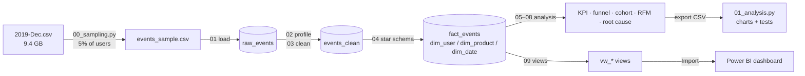
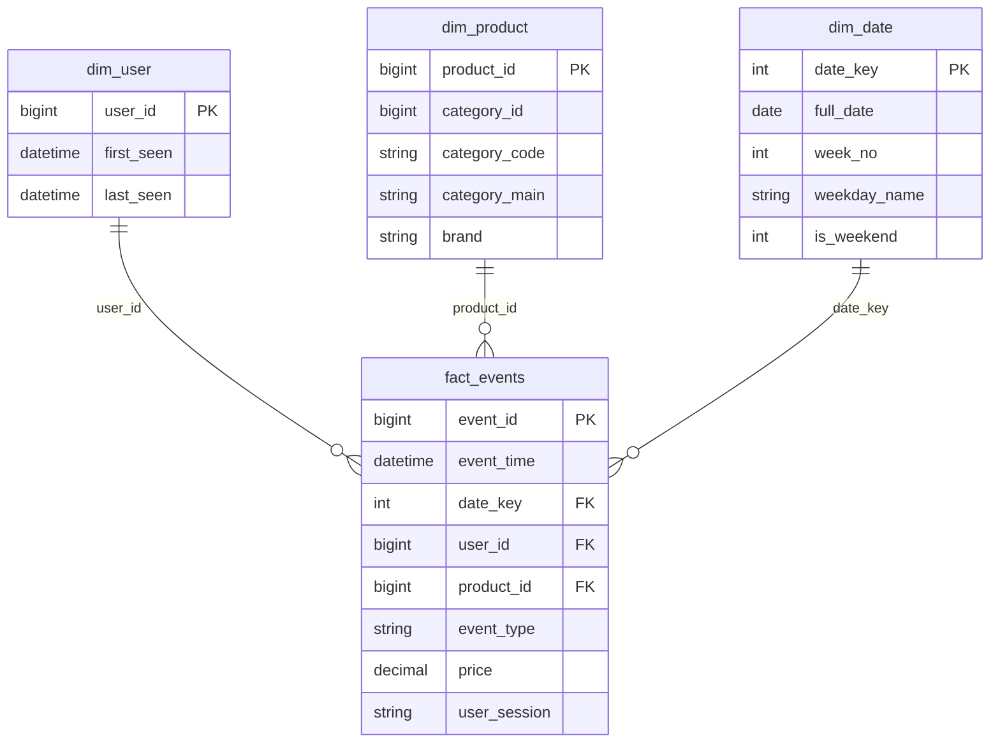
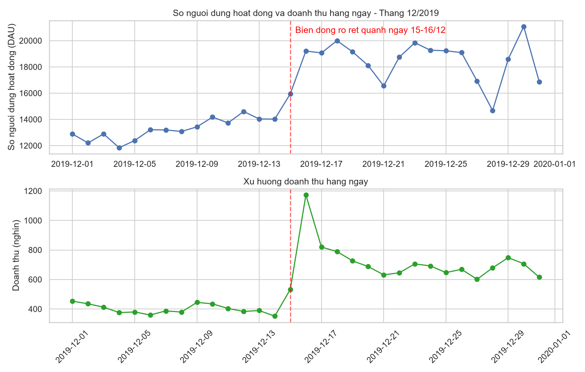
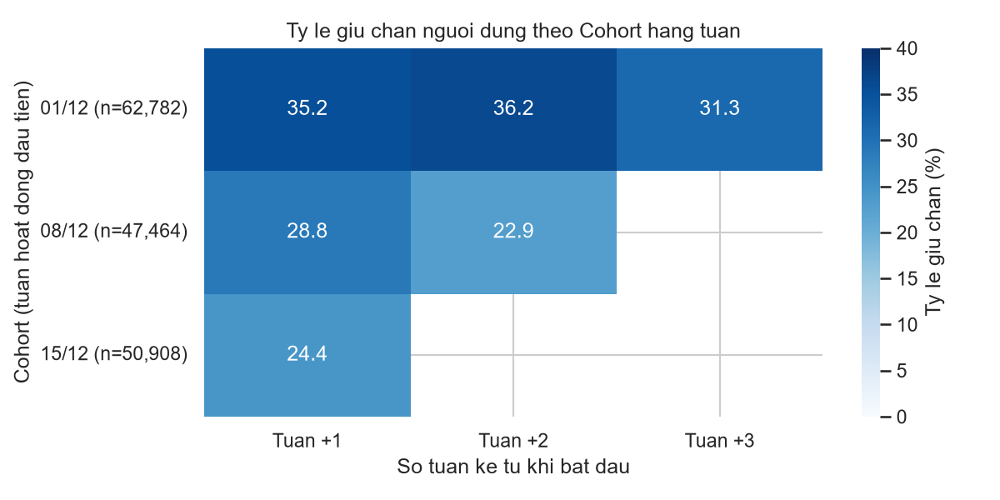
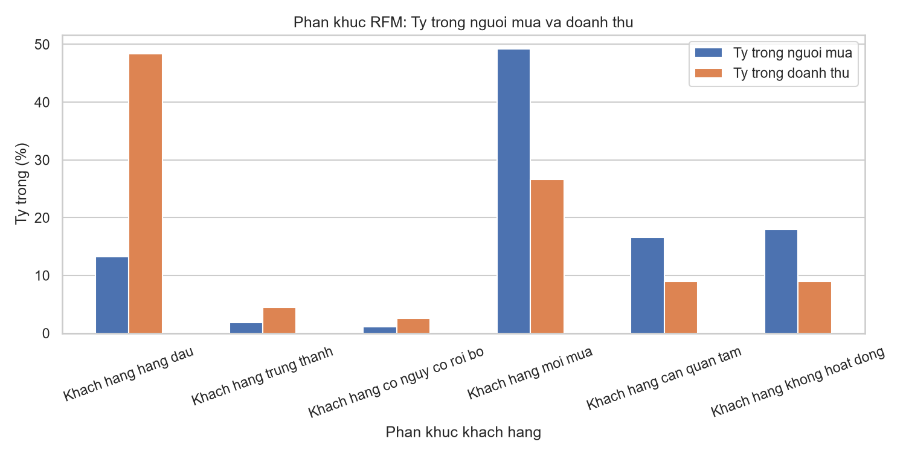

# E-commerce User Behavior Analytics: Funnel, Retention and Root-Cause Analysis


End-to-end data analytics project on one month of e-commerce event data (December 2019): **SQL Server** for cleaning, modeling and metrics, **Python** for charts and statistical tests, **Power BI** for the dashboard.

🇻🇳 Bản tiếng Việt: [README.vi.md](README.vi.md)

**Author:** Nguyen Duc Hoang · [GitHub: gonah7](https://github.com/gonah7)

---

## Table of contents

1. [Executive summary](#1-executive-summary)
2. [Business problem](#2-business-problem)
3. [Dataset](#3-dataset)
4. [Tools and workflow](#4-tools-and-workflow)
5. [Data cleaning](#5-data-cleaning)
6. [Data model](#6-data-model)
7. [Analysis and results](#7-analysis-and-results)
8. [Dashboard](#8-dashboard)
9. [Recommendations](#9-recommendations)
10. [Limitations](#10-limitations)
11. [Repository structure](#11-repository-structure)
12. [How to reproduce](#12-how-to-reproduce)
13. [Data credit](#13-data-credit)

---

## 1. Executive summary

**Headline:** revenue per day rose **+81%** after 15 December (399,193 → 720,914) and stayed at the higher level for the rest of the month. The gain came from **more daily users (57%)** and a **higher buyer rate (35%)**, almost entirely from **returning users (97%)**; order value barely moved.

| Question | Answer | Evidence |
|---|---|---|
| 1. Where is the biggest funnel drop-off? | **View → cart**: only 12.9% of viewing sessions add to cart; 48.3% of carts are then bought | Construction converts best at both steps (15.6%, 54.6%); computers, kids, accessories add to cart least (5.7%, 5.5%, 4.9%) |
| 2. Do users come back? | About **1 in 3** users of the first week returned in each later week | 1 Dec cohort: 35.2% / 36.2% / 31.3% in weeks +1 / +2 / +3 |
| 3. Who generates the revenue? | **Champions are 13% of buyers but 48% of revenue**; 66% of buyers bought in only one session | Top 1% of buyers = 22% of revenue, top 10% = 57% |
| 4. Why did revenue jump after 15 Dec? | More daily users (+40%) and a higher buyer rate (+1.61 pp); returning users drove ~97% of the increase; nearly every category grew | Still +77% without the 10 largest buyers, +73% without the 16 Dec spike |
| 5. Is it more than noise? | Yes. Buyer rate per user-day **+2.03 pp** (95% CI 1.81–2.22); odds ratio 1.236 (1.198–1.275) | Every day after 15 Dec had higher revenue than every day before |

The data shows **what** changed but not **why** (promotion, campaign, seasonality). Answering that needs data outside this dataset, such as a marketing calendar.

---

## 2. Business problem

An online store wants to understand how users behave, where they drop off before buying, and why sales moved sharply during December 2019. The audience is the management and marketing team, who need answers they can act on.

**Questions**
1. Where is the largest drop-off in the funnel (view → cart → purchase), and does it differ by category?
2. How many users come back in later weeks?
3. Which customer segments generate most of the revenue?
4. Why did revenue per day jump after 15 December: more traffic, higher conversion or higher order value? New or returning users? A few buyers or a few categories?
5. Is the change distinguishable from noise, and how large is it?

---

## 3. Dataset

- **Source:** [eCommerce behavior data from multi category store](https://www.kaggle.com/datasets/mkechinov/ecommerce-behavior-data-from-multi-category-store) (REES46, Kaggle), file `2019-Dec.csv` (about 9.4 GB). Raw and derived data are **not** included in this repository.
- **Grain:** one row per user event.
- **Fields:** `event_time`, `event_type` (view / cart / purchase), `product_id`, `category_id`, `category_code`, `brand`, `price`, `user_id`, `user_session`.
- **Sampling:** the full file is too large for a personal machine, so I kept a **user-level sample** (5% of users, chosen by a hash of `user_id`) with **all events of each sampled user**. Sampling users keeps every journey intact; sampling random rows would break funnels and cohorts. Script: [`notebooks/00_sampling.py`](notebooks/00_sampling.py).
- **Sample size:** 3,346,915 events from 228,713 users, 1–31 December 2019 (228,656 users remain after cleaning).

**Data files used in the project** (all in `data/`, not tracked):

| File | Rows | Produced by | Used by |
|---|---|---|---|
| `2019-Dec.csv` | ~67M | Kaggle download | `00_sampling.py` |
| `events_sample.csv` | 3,346,915 | `00_sampling.py` | `sql/01` (`BULK INSERT`) |
| `daily_kpi.csv` | 31 | `sql/05`, daily KPI query | `01_analysis.py` |
| `cohort.csv` | 10 | `sql/06` | `01_analysis.py` |
| `user_rfm.csv` | 25,199 | `sql/07`, table `dbo.user_rfm` | `01_analysis.py` |
| `user_day.csv` | 498,045 | `sql/08`, user-day CTE (`user_id, full_date, user_type, bought, revenue`) | `01_analysis.py` |

---

## 4. Tools and workflow

| Tool | Used for |
|---|---|
| SQL Server Express + SSMS | Loading, profiling, cleaning, star schema, KPIs, cohort, RFM, root cause, dashboard views |
| Python (pandas, matplotlib, seaborn, scipy, statsmodels) | Sampling, charts, bootstrap confidence intervals, logistic regression |
| Power BI Desktop (Power Query, DAX) | Interactive dashboard on top of the SQL views |



| Step | File | Output |
|---|---|---|
| 1. Sample raw data | [`notebooks/00_sampling.py`](notebooks/00_sampling.py) | `events_sample.csv` |
| 2. Create database and load | [`sql/01_create_and_load.sql`](sql/01_create_and_load.sql) | `raw_events` |
| 3. Profile data quality | [`sql/02_profiling.sql`](sql/02_profiling.sql) | missing values, invalid prices, duplicates |
| 4. Clean | [`sql/03_cleaning.sql`](sql/03_cleaning.sql) | `events_clean` |
| 5. Build star schema | [`sql/04_star_schema.sql`](sql/04_star_schema.sql) | `fact_events`, `dim_user`, `dim_product`, `dim_date` |
| 6. KPIs, DAU/MAU, funnel | [`sql/05_kpi_funnel.sql`](sql/05_kpi_funnel.sql) | overall and daily KPIs, session funnel |
| 7. Cohort retention | [`sql/06_cohort_retention.sql`](sql/06_cohort_retention.sql) | weekly cohort table |
| 8. RFM segmentation | [`sql/07_rfm.sql`](sql/07_rfm.sql) | `user_rfm` |
| 9. Root-cause analysis | [`sql/08_root_cause.sql`](sql/08_root_cause.sql) | before/after decomposition |
| 10. Dashboard views | [`sql/09_dashboard_views.sql`](sql/09_dashboard_views.sql) | six `vw_*` views |
| 11. Charts and statistical tests | [`notebooks/01_analysis.py`](notebooks/01_analysis.py) | `report/figures/*.png`, test results |
| 12. Dashboard | [`dashboard/ecom_behavior.pbix`](dashboard/ecom_behavior.pbix) | 4-page report |

---

## 5. Data cleaning

| Check | Result | Decision |
|---|---|---|
| Missing time, user, session, product, price | 0 rows | none needed |
| Price ≤ 0 | 3,689 rows (0.11%); 3,602 view, 87 cart, **0 purchase** | removed (no impact on revenue) |
| Duplicate events (same time, type, product, user, session) | 5,901 rows (0.18%); **98% were cart events** (5,802), 97 view, 2 purchase | removed (would inflate add-to-cart events by about 3.4%) |
| Missing `brand` | 399,712 rows (11.9%) | kept, labeled `unknown` |
| Missing `category_code` | 349,229 rows (10.4%) | kept, labeled `unknown` |

**Result:** 3,346,915 → **3,337,332 rows** (9,583 removed, 0.29%; 7 rows were both duplicate and price ≤ 0). Rows with missing brand or category were kept because dropping them would remove about 10–12% of real behavior and distort funnels and retention.

---

## 6. Data model

### 6.1 SQL star schema

`fact_events` (3,337,332 rows) joined to `dim_user` (228,656), `dim_product` (122,166) and `dim_date` (31). A referential integrity check found **0 orphan rows** in all three joins.



### 6.2 Power BI model

The dashboard imports pre-aggregated SQL views (fast and small) instead of the 3.3M-row fact table:

| Table | Source | Purpose |
|---|---|---|
| `vw_daily_kpi` | view | DAU, sessions, buyers, purchases, revenue per day |
| `vw_daily_usertype` | view | users, buyers, revenue per day for new vs returning users |
| `vw_funnel_category` | view | view / cart / purchase sessions per category |
| `vw_summary` | view | platform-wide session funnel and total users |
| `vw_cohort` | view | weekly cohort retention |
| `vw_category_period` | view | revenue per category before / after 15 Dec |
| `user_rfm` | table | one row per buyer with RFM scores and segment |
| `dim_calendar` | DAX | dates with `Period` (Before / Transition / After), `Window` and `Week` |
| `dim_category` | DAX | shared category slicer; `category_size` hides categories with < 10k view sessions |
| `Funnel Step`, `Revenue Driver`, `KPI List` | DAX | small helper tables for the funnel, the driver decomposition and the before/after table |
| `_Measures` | DAX | 86 measures, grouped in display folders |

`dim_calendar` filters `vw_daily_kpi` and `vw_daily_usertype` by date; `dim_category` filters `vw_funnel_category` and `vw_category_period`.

---

## 7. Analysis and results

### 7.1 Key metrics

| Metric | Value |
|---|---|
| Events / users / sessions | 3,337,332 / 228,656 / 765,778 |
| Buyers | 25,199 (11.0% of users) |
| Purchase events | 58,003 |
| Revenue (sum of purchase prices) | 17,656,541 |
| Average DAU | 16,066 |
| Stickiness (avg DAU / MAU) | 7.03% |



Average DAU rises from about 13,300 (1–14 Dec) to about 18,500 (16–31 Dec) and stays there. Daily revenue peaks on 16 December (1.17M) and then settles between 600 and 820 thousand, above every day of the first half of the month (maximum 453 thousand).

### 7.2 Funnel

Session-level funnel (a session counts at a step if it contains that event; order is not checked):

| Step | Sessions | Rate |
|---|---|---|
| View | 765,615 | |
| View → cart | 98,596 | 12.88% |
| Cart → purchase | 47,629 | 48.31% of cart sessions |
| View → purchase | | 6.22% |

666 sessions contain a purchase without a cart event in the same session. 50,967 sessions added to cart without buying.

| Category | View sessions | View → cart | Cart → purchase |
|---|---|---|---|
| construction | 255,017 | **15.62%** | **54.56%** |
| appliances | 157,907 | 9.96% | 46.64% |
| apparel | 142,264 | 8.12% | 43.49% |
| electronics | 116,548 | 7.55% | 46.85% |
| unknown | 107,465 | 9.22% | 38.52% |
| sport | 65,918 | 10.12% | 48.09% |
| computers | 60,534 | 5.68% | 44.46% |
| furniture | 52,476 | 7.48% | 42.01% |
| kids | 33,043 | 5.51% | 39.56% |
| accessories | 16,285 | 4.88% | 38.16% |
| auto | 11,777 | 6.08% | 43.58% |

- Categories with fewer than 10,000 viewing sessions (country_yard, stationery, medicine) are not interpreted because their rates are unstable.
- **Rate vs volume:** construction has the best cart → purchase rate, yet it loses the most carts in absolute terms (about 18,100 abandoned cart sessions, roughly a third of all), simply because of its traffic. Products with **unknown** category abandon 61% of carts.

### 7.3 Cohort retention



| Cohort (first active week) | Size | Week +1 | Week +2 | Week +3 |
|---|---|---|---|---|
| 1 Dec | 62,782 | 35.2% | 36.2% | 31.3% |
| 8 Dec | 47,464 | 28.8% | 22.9% | |
| 15 Dec | 50,908 | 24.4% | | |
| 22 Dec | 47,070 | | | |

The last three days (29–31 Dec) do not form a full week and are excluded. **Do not read the decline across cohorts as worsening retention**: the data starts on 1 December, so the first cohort contains every long-time customer active that week, while later cohorts only contain users who were absent in earlier weeks.

### 7.4 RFM segmentation



| Segment | Rule | Buyers | % of buyers | Revenue | % of revenue | Avg spend |
|---|---|---|---|---|---|---|
| Champions | last purchase ≤ 14 days, 3+ sessions | 3,347 | 13.28% | 8,544,383 | **48.39%** | 2,553 |
| Recent buyers | ≤ 14 days, 1–2 sessions | 12,395 | 49.19% | 4,705,270 | 26.65% | 380 |
| Hibernating | > 21 days, 1–2 sessions | 4,529 | 17.97% | 1,588,551 | 9.00% | 351 |
| Need attention | 15–21 days, 1–2 sessions | 4,182 | 16.60% | 1,575,620 | 8.92% | 377 |
| Loyal | 15–21 days, 3+ sessions | 469 | 1.86% | 787,155 | 4.46% | 1,678 |
| At risk | > 21 days, 3+ sessions | 277 | 1.10% | 455,561 | 2.58% | 1,645 |

- **Recency** = days since last purchase, counted to 1 Jan 2020 (≤7 days = 5, ≤14 = 4, ≤21 = 3, ≤28 = 2, else 1). **Frequency** = number of distinct sessions with a purchase (the data has no order id).
- Top 1% of buyers = 22.2% of revenue; top 10% = 57.2%. The 10 largest buyers contribute 5.9% of revenue; the largest spent 412,667 across 97 sessions (428 purchase events), which looks more like a business or reseller account than a typical shopper.
- Purchase frequency: 65.6% of buyers bought in 1 session, 18.1% in 2, 16.2% in 3 or more.
- Because the data covers one month, "Loyal" and "At risk" are small groups and recency has limited spread.

### 7.5 Root-cause analysis of the step change

Comparison windows: **before = 1–14 Dec, after = 16–31 Dec** (15 Dec is a transition day and is excluded).

**Where did the increase come from?**

| | Before | After | Change | Share of the revenue increase |
|---|---|---|---|---|
| Average DAU | 13,264 | 18,525 | +39.7% | **57%** |
| Buyers per DAU | 7.03% | 8.64% | +1.61 pp | **35%** |
| Purchases per buyer | 1.42 | 1.48 | +4.2% | 7% |
| Revenue per purchase | 301.99 | 304.96 | +1.0% | 2% |
| **Revenue per day** | **399,193** | **720,914** | **+80.6%** | 100% |

Revenue per day = DAU × buyers per DAU × purchases per buyer × revenue per purchase, so the shares come from splitting the change on a log scale (each factor's log ratio divided by the log ratio of revenue). Buyers per day rose from 932 to 1,600 (+71.6%). Order value is essentially unchanged.

**New or returning users?** (windows 8–14 Dec vs 16–31 Dec, so that the "new user" definition is not distorted by the start of the data)

| | Before | After | Change |
|---|---|---|---|
| New users per day | about 6,780 | about 6,960 | +2.7% |
| Returning users per day | about 7,090 | about 11,560 | **+63%** |
| Buyer rate, new users | 4.82% | 5.08% | +0.27 pp |
| Buyer rate, returning users | 8.33% | 10.78% | **+2.45 pp** |
| Revenue per day, new users | 136,345 | 144,485 | +6% |
| Revenue per day, returning users | 261,741 | 576,428 | **+120%** |

Returning users account for about **97%** of the increase in daily revenue. Of the +2.03 pp rise in buyer rate per user-day, about **three quarters is a real increase within each group** and about a quarter is a mix effect (more returning users, who buy more often). The exact split is 20–32% mix depending on which period's weights are used; 26% with average weights.

**Is it driven by a few buyers or one category?**
- Excluding the 10 largest buyers: revenue per day 380,380 → 673,341 (**+77%**), so the result does not depend on a few accounts.
- Excluding the 16 Dec spike: average daily revenue after ≈ 690,800, still **+73%**.
- By category, construction contributes the most in absolute terms (56.7% of the increase) only because it is about two thirds of revenue; its growth (+68%) is below the platform average (+81%). Nearly every category grew (appliances +99%, electronics +127%, apparel +98%, sport +120%), which points to a platform-wide effect rather than one category.

### 7.6 Statistical tests

Before/after comparison of the **buyer rate per user-day** (8–14 Dec vs 16–31 Dec). A user appears on many days, so confidence intervals come from a bootstrap that **resamples users** (2,000 draws):

| Group | Before | After | Difference | 95% CI |
|---|---|---|---|---|
| All | 6.61% | 8.64% | +2.03 pp | 1.81 – 2.22 |
| New users | 4.82% | 5.08% | +0.27 pp | 0.03 – 0.50 |
| Returning users | 8.33% | 10.78% | +2.45 pp | 2.14 – 2.76 |

- **Logistic regression** with standard errors clustered by user, controlling for user type: odds ratio **1.236** (95% CI 1.198–1.275).
- **Daily revenue** (14 days before vs 16 days after): every "after" day is above every "before" day (Mann–Whitney U = 224, the maximum possible). With 30 consecutive days these p-values are descriptive only.
- The effect for new users is statistically distinguishable from zero but practically tiny. Effect sizes and intervals are reported rather than p-values, which are extremely small simply because of the sample size.

> Buyers per DAU in 7.5 (+1.61 pp) and buyer rate per user-day here (+2.03 pp) are different metrics with different "before" windows (1–14 Dec vs 8–14 Dec), so the numbers differ.

---

## 8. Dashboard

**File:** [`dashboard/ecom_behavior.pbix`](dashboard/ecom_behavior.pbix) (Power BI Desktop, Import mode from SQL Server).

Every page has the same layout: a left panel (page navigation, page filters, "Clear all filters"), a banner with five KPI cards, then the visuals in reading order (top-left → top-right → bottom-left → bottom-right) so each page tells one story: **what happened → why → who → what to do**.

| Page | Question | KPI cards | Visuals, in reading order |
|---|---|---|---|
| **Overview** | How did December go? | Revenue, daily active users, buyers per day, conversion, revenue per purchase — each with ▲/▼ change vs 1–14 Dec and a sparkline | Daily revenue and DAU (15 Dec marked) → weekly performance table (did the change last?) → revenue by new vs returning users. Filters: date, period, day type |
| **Growth Drivers** | Why did revenue per day rise 81%? | Revenue per day after 15 Dec, extra revenue per day, share from more users, share from buyer rate, share from returning users | Before/after table → driver decomposition → new vs returning revenue → change by user type → growth by category |
| **Conversion Funnel** | Where do shoppers drop off? | View sessions, view → cart, cart → purchase, view → purchase, cart abandonment — compared with all categories when one is selected | Session funnel → category scatter (add-to-cart rate vs purchase rate, bubble = traffic) → abandoned carts by category → category table. Filter: category |
| **Customers** | Who buys and who comes back? | Buyers, one-time buyers, top 10% revenue share, Champions' revenue share, next-week return rate | Share of buyers vs share of revenue by RFM segment → purchase sessions per buyer → weekly cohort retention → segment playbook with a suggested action per segment. Filter: segment |

Key DAX measures (table `_Measures`):

| Folder | Examples |
|---|---|
| Overview | `Revenue`, `Avg DAU`, `Buyers per DAU`, `Revenue per Purchase`, `Avg Buyers per Day` |
| What changed | `KPI Before` / `KPI After` / `KPI Change` (dynamic format), `Driver Share of Increase`, `UT Share of Increase`, `Cat Growth %` |
| Funnel | `Funnel Sessions`, `View to Cart %`, `Cart to Purchase %`, `Cart Abandonment %`, `Abandoned Cart Sessions` |
| Customers | `% of Buyers`, `% of Revenue`, `One-Session Buyers %`, `Top 10% Revenue Share`, `Champions Revenue Share`, `Segment Action` |
| Retention | `Retention %`, `Week 1 Retention` |
| Labels | `KPI Delta …` (▲/▼ text) and `KPI Color …` (green/red, used for conditional formatting) |

---

## 9. Recommendations

These are hypotheses for the business to test, not conclusions drawn from the data.

1. **Find the cause of the 15–16 Dec step change** by checking the promotion and advertising calendar. If a campaign explains it, measure how many of the extra returning users remain active afterwards.
2. **Protect and grow the Champions segment** (13% of buyers, 48% of revenue): early access, loyalty benefits, and monitoring of this group's activity as an early-warning signal.
3. **Convert one-time buyers** (66% of buyers) with post-purchase follow-up and category-based recommendations.
4. **Recover abandoned carts where the volume is**: construction alone has about 18,100 abandoned cart sessions; cart reminders there reach the most shoppers.
5. **Investigate low add-to-cart categories** (computers, kids, accessories) and the **cart → purchase** step for products with missing category (38.5%), looking at price, content quality and checkout friction.
6. **Fix catalog data quality:** about 10–12% of events have no brand or category, which limits every category analysis.
7. **Track buyer concentration** (top 10 buyers ≈ 6% of revenue) and separate business or reseller accounts from consumers in reporting.

---

## 10. Limitations

- Observational before/after comparison: it shows **what** changed, not **why**.
- Single month of data: short windows for recency and retention; no seasonality or year-over-year view.
- "New" users means first seen in this data, not necessarily new customers; cohort retention across cohorts is not comparable for the reason given in section 7.3.
- Revenue is the sum of purchase prices (no quantity or order id); "frequency" counts sessions with a purchase.
- The funnel is session-level and does not check event order; purchases without a cart in the same session (666) are not counted at the cart step. In the per-category funnel a session that touches several categories is counted in each of them.
- The driver shares (57% / 35% / 7% / 2%) and the mix vs within-group split are decompositions, not causal effects; the mix share depends on the weighting (20–32%).
- 5% user-level sample, so absolute numbers are smaller than the full platform; rates and comparisons are the meaningful outputs.
- Missing brand and category (about 10–12%) are labeled `unknown`.

---

## 11. Repository structure

```
ecommerce-user-behavior-analytics/
├── README.md                      English documentation
├── README.vi.md                   Vietnamese documentation
├── requirements.txt               Python dependencies
├── data/                          not tracked (see .gitignore)
│   ├── 2019-Dec.csv               raw Kaggle file
│   ├── events_sample.csv          5% user sample
│   └── daily_kpi.csv, cohort.csv, user_rfm.csv, user_day.csv   SQL exports for Python
├── sql/
│   ├── 01_create_and_load.sql     database, raw table, BULK INSERT
│   ├── 02_profiling.sql           data quality checks
│   ├── 03_cleaning.sql            events_clean
│   ├── 04_star_schema.sql         fact and dimension tables, indexes, integrity checks
│   ├── 05_kpi_funnel.sql          KPIs, DAU/MAU, session funnel
│   ├── 06_cohort_retention.sql    weekly cohorts
│   ├── 07_rfm.sql                 RFM scores and segments
│   ├── 08_root_cause.sql          before/after decomposition
│   └── 09_dashboard_views.sql     views used by Power BI
├── notebooks/
│   ├── 00_sampling.py             user-level sampling of the raw file
│   └── 01_analysis.py             charts and statistical tests
├── report/
│   └── figures/                   01_daily_trend.png, 02_cohort_heatmap.png, 03_rfm_segments.png
└── dashboard/
    └── ecom_behavior.pbix         Power BI report
```

---

## 12. How to reproduce

**Requirements:** SQL Server 2016 SP1 or later (Express is enough) with SSMS, Python 3.10+, Power BI Desktop.

1. **Get the data.** Download `2019-Dec.csv` from Kaggle into `data/`.
2. **Sample.** From the project root:
   ```bash
   pip install -r requirements.txt
   ```
   ```bash
   python notebooks/00_sampling.py
   ```
3. **Build the database.** In SSMS run `sql/01` to `sql/04` in order. In `01_create_and_load.sql`, change the `BULK INSERT` path to where `events_sample.csv` is (the SQL Server service account must be able to read it).
4. **Run the analysis.** Run `sql/05` to `sql/08`, then `sql/09` to create the dashboard views.
5. **Export CSVs for Python** into `data/` (in SSMS: *Results → Save Results As…*), as listed in section 3: `daily_kpi.csv`, `cohort.csv`, `user_rfm.csv`, `user_day.csv`. Files with or without a header row both work.
6. **Charts and tests.**
   ```bash
   python notebooks/01_analysis.py
   ```
   It prints the test results and writes the charts to `report/figures/`.
7. **Dashboard.** Open `dashboard/ecom_behavior.pbix`. If your SQL Server instance has a different name, update it in *Transform data → Data source settings*, then **Refresh**.

**Validation.** Every number in this README was re-checked against the database (`EcomBehavior`) and by re-running `01_analysis.py`; the script reproduces the test results and the three figures exactly. The total revenue matches across SQL, the revenue-bearing CSV exports (`daily_kpi`, `user_rfm`, `user_day`) and Power BI (17,656,541.49).

---

## 13. Data credit

Dataset: REES46 eCommerce behavior data via Kaggle (public). This is a personal learning project and is not affiliated with the data provider.
