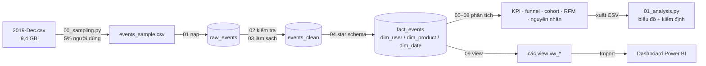
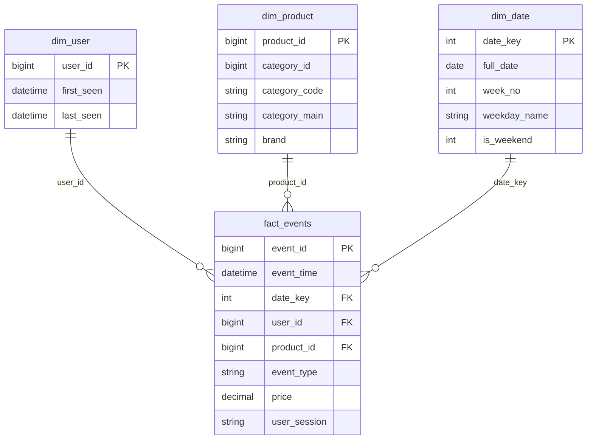
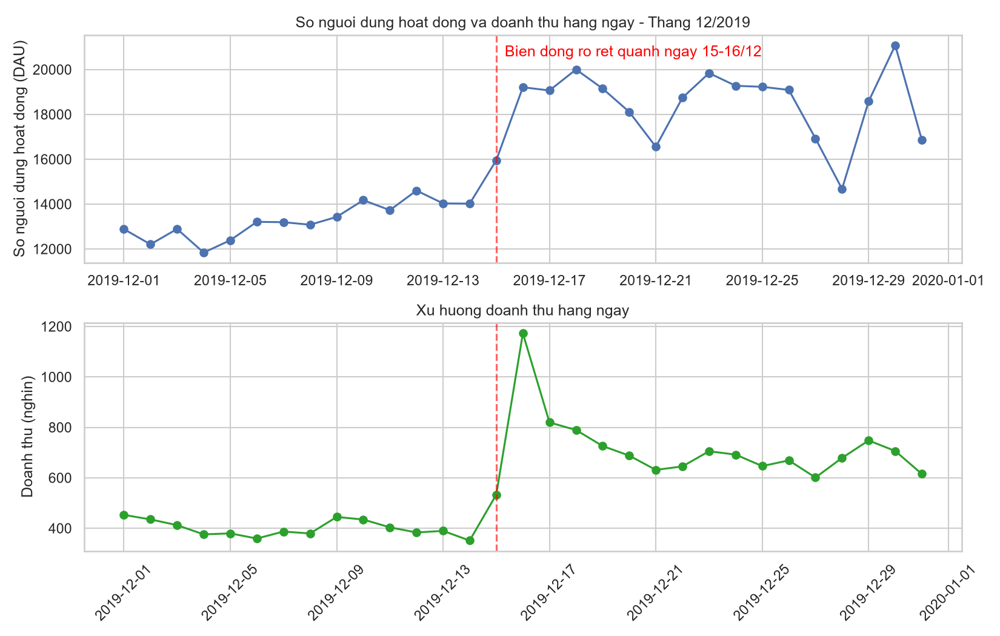
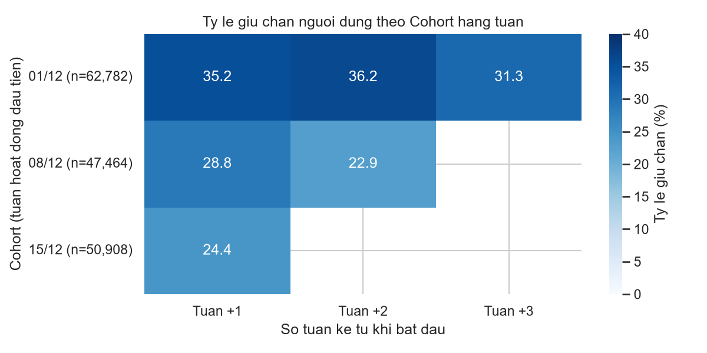
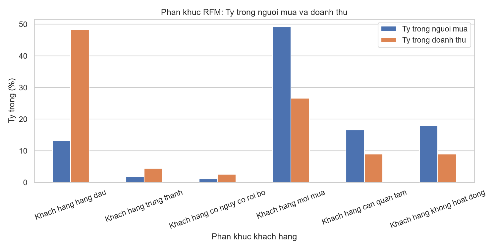

# Phân tích hành vi người dùng thương mại điện tử: Funnel, Retention và Root-Cause


Dự án phân tích dữ liệu từ đầu đến cuối trên một tháng dữ liệu sự kiện thương mại điện tử (tháng 12/2019): **SQL Server** để làm sạch, mô hình hóa và tính chỉ số, **Python** để vẽ biểu đồ và kiểm định thống kê, **Power BI** để dựng dashboard.

🇬🇧 English version: [README.md](README.md)

**Tác giả:** Nguyen Duc Hoang · [GitHub: gonah7](https://github.com/gonah7)

---

## Mục lục

1. [Tóm tắt kết quả](#1-tóm-tắt-kết-quả)
2. [Bài toán kinh doanh](#2-bài-toán-kinh-doanh)
3. [Dữ liệu](#3-dữ-liệu)
4. [Công cụ và quy trình](#4-công-cụ-và-quy-trình)
5. [Làm sạch dữ liệu](#5-làm-sạch-dữ-liệu)
6. [Mô hình dữ liệu](#6-mô-hình-dữ-liệu)
7. [Phân tích và kết quả](#7-phân-tích-và-kết-quả)
8. [Dashboard](#8-dashboard)
9. [Đề xuất](#9-đề-xuất)
10. [Hạn chế](#10-hạn-chế)
11. [Cấu trúc repo](#11-cấu-trúc-repo)
12. [Cách chạy lại](#12-cách-chạy-lại)
13. [Nguồn dữ liệu](#13-nguồn-dữ-liệu)

---

## 1. Tóm tắt kết quả

**Kết luận chính:** doanh thu mỗi ngày tăng **+81%** sau ngày 15/12 (399.193 → 720.914) và giữ ở mức cao đến hết tháng. Mức tăng đến từ **nhiều người dùng hằng ngày hơn (57%)** và **tỷ lệ mua cao hơn (35%)**, gần như toàn bộ từ **người dùng quay lại (97%)**; giá trị mỗi đơn gần như không đổi.

| Câu hỏi | Trả lời | Bằng chứng |
|---|---|---|
| 1. Phễu rơi rụng nhiều nhất ở đâu? | Ở bước **xem → thêm giỏ**: chỉ 12,9% phiên xem có thêm giỏ; sau đó 48,3% giỏ được mua | Construction chuyển đổi tốt nhất ở cả hai bước (15,6%, 54,6%); computers, kids, accessories thêm giỏ thấp nhất (5,7%, 5,5%, 4,9%) |
| 2. Người dùng có quay lại không? | Khoảng **1/3** người dùng của tuần đầu quay lại ở mỗi tuần sau | Cohort 01/12: 35,2% / 36,2% / 31,3% ở tuần +1 / +2 / +3 |
| 3. Ai tạo ra doanh thu? | **Champions chiếm 13% người mua nhưng 48% doanh thu**; 66% người mua chỉ mua trong một phiên | Top 1% người mua = 22% doanh thu, top 10% = 57% |
| 4. Vì sao doanh thu tăng sau 15/12? | Nhiều người dùng hằng ngày hơn (+40%) và tỷ lệ mua cao hơn (+1,61 điểm %); người dùng quay lại đóng góp ~97% mức tăng; gần như mọi danh mục đều tăng | Vẫn +77% khi bỏ 10 người mua lớn nhất, +73% khi bỏ ngày đột biến 16/12 |
| 5. Có phải chỉ là dao động ngẫu nhiên? | Không. Tỷ lệ mua theo người-ngày **+2,03 điểm %** (KTC 95%: 1,81–2,22); tỷ số odds 1,236 (1,198–1,275) | Mọi ngày sau 15/12 đều có doanh thu cao hơn mọi ngày trước đó |

Dữ liệu cho biết **điều gì** thay đổi nhưng **không** cho biết **vì sao** (khuyến mãi, chiến dịch quảng cáo hay mùa mua sắm). Muốn trả lời cần dữ liệu ngoài bộ này, ví dụ lịch marketing.

---

## 2. Bài toán kinh doanh

Một cửa hàng trực tuyến muốn hiểu hành vi người dùng, biết họ rơi rụng ở đâu trước khi mua, và giải thích vì sao doanh số biến động mạnh trong tháng 12/2019. Đối tượng sử dụng kết quả là ban quản lý và đội marketing, những người cần câu trả lời để hành động.

**Các câu hỏi**
1. Bước nào trong phễu (xem → giỏ → mua) rơi rụng nhiều nhất, và có khác nhau giữa các danh mục không?
2. Bao nhiêu người dùng quay lại ở các tuần sau?
3. Nhóm khách hàng nào tạo ra phần lớn doanh thu?
4. Vì sao doanh thu mỗi ngày tăng vọt sau 15/12: nhiều người truy cập hơn, tỷ lệ mua cao hơn hay giá trị đơn cao hơn? Do người dùng mới hay cũ? Có tập trung vào vài người mua hoặc vài danh mục không?
5. Mức thay đổi có khác biệt so với dao động ngẫu nhiên không, và lớn đến đâu?

---

## 3. Dữ liệu

- **Nguồn:** [eCommerce behavior data from multi category store](https://www.kaggle.com/datasets/mkechinov/ecommerce-behavior-data-from-multi-category-store) (REES46, Kaggle), file `2019-Dec.csv` (khoảng 9,4 GB). Dữ liệu thô và dữ liệu trung gian **không** được đưa vào repo.
- **Mức chi tiết:** mỗi dòng là một sự kiện của người dùng.
- **Các trường:** `event_time`, `event_type` (view / cart / purchase), `product_id`, `category_id`, `category_code`, `brand`, `price`, `user_id`, `user_session`.
- **Lấy mẫu:** file gốc quá lớn cho máy cá nhân, nên tôi lấy **mẫu theo người dùng** (5% người dùng, chọn bằng hàm băm của `user_id`) và giữ **toàn bộ sự kiện** của mỗi người được chọn. Lấy mẫu theo người dùng giúp giữ nguyên hành trình; nếu lấy ngẫu nhiên từng dòng thì funnel và cohort sẽ bị sai. Script: [`notebooks/00_sampling.py`](notebooks/00_sampling.py).
- **Quy mô mẫu:** 3.346.915 sự kiện của 228.713 người dùng, từ 01 đến 31/12/2019 (còn 228.656 người dùng sau khi làm sạch).

**Các file dữ liệu trong dự án** (nằm trong `data/`, không đưa lên Git):

| File | Số dòng | Tạo bởi | Dùng cho |
|---|---|---|---|
| `2019-Dec.csv` | ~67 triệu | tải từ Kaggle | `00_sampling.py` |
| `events_sample.csv` | 3.346.915 | `00_sampling.py` | `sql/01` (`BULK INSERT`) |
| `daily_kpi.csv` | 31 | `sql/05`, truy vấn KPI theo ngày | `01_analysis.py` |
| `cohort.csv` | 10 | `sql/06` | `01_analysis.py` |
| `user_rfm.csv` | 25.199 | `sql/07`, bảng `dbo.user_rfm` | `01_analysis.py` |
| `user_day.csv` | 498.045 | `sql/08`, CTE người-ngày (`user_id, full_date, user_type, bought, revenue`) | `01_analysis.py` |

---

## 4. Công cụ và quy trình

| Công cụ | Dùng để |
|---|---|
| SQL Server Express + SSMS | Nạp, kiểm tra, làm sạch dữ liệu, star schema, KPI, cohort, RFM, phân tích nguyên nhân, view cho dashboard |
| Python (pandas, matplotlib, seaborn, scipy, statsmodels) | Lấy mẫu, biểu đồ, khoảng tin cậy bootstrap, hồi quy logistic |
| Power BI Desktop (Power Query, DAX) | Dashboard tương tác dựa trên các view SQL |



| Bước | File | Kết quả |
|---|---|---|
| 1. Lấy mẫu dữ liệu thô | [`notebooks/00_sampling.py`](notebooks/00_sampling.py) | `events_sample.csv` |
| 2. Tạo database và nạp dữ liệu | [`sql/01_create_and_load.sql`](sql/01_create_and_load.sql) | `raw_events` |
| 3. Kiểm tra chất lượng dữ liệu | [`sql/02_profiling.sql`](sql/02_profiling.sql) | giá trị thiếu, giá không hợp lệ, dòng trùng |
| 4. Làm sạch | [`sql/03_cleaning.sql`](sql/03_cleaning.sql) | `events_clean` |
| 5. Dựng star schema | [`sql/04_star_schema.sql`](sql/04_star_schema.sql) | `fact_events`, `dim_user`, `dim_product`, `dim_date` |
| 6. KPI, DAU/MAU, funnel | [`sql/05_kpi_funnel.sql`](sql/05_kpi_funnel.sql) | KPI tổng và theo ngày, funnel theo phiên |
| 7. Cohort retention | [`sql/06_cohort_retention.sql`](sql/06_cohort_retention.sql) | bảng cohort theo tuần |
| 8. Phân khúc RFM | [`sql/07_rfm.sql`](sql/07_rfm.sql) | `user_rfm` |
| 9. Phân tích nguyên nhân gốc | [`sql/08_root_cause.sql`](sql/08_root_cause.sql) | phân rã trước/sau |
| 10. View cho dashboard | [`sql/09_dashboard_views.sql`](sql/09_dashboard_views.sql) | sáu view `vw_*` |
| 11. Biểu đồ và kiểm định thống kê | [`notebooks/01_analysis.py`](notebooks/01_analysis.py) | `report/figures/*.png`, kết quả kiểm định |
| 12. Dashboard | [`dashboard/ecom_behavior.pbix`](dashboard/ecom_behavior.pbix) | báo cáo 4 trang |

---

## 5. Làm sạch dữ liệu

| Kiểm tra | Kết quả | Quyết định |
|---|---|---|
| Thiếu thời gian, user, session, sản phẩm, giá | 0 dòng | không cần xử lý |
| Giá ≤ 0 | 3.689 dòng (0,11%); 3.602 view, 87 cart, **0 purchase** | loại bỏ (không ảnh hưởng doanh thu) |
| Sự kiện trùng lặp (cùng thời điểm, loại, sản phẩm, user, phiên) | 5.901 dòng (0,18%); **98% là sự kiện cart** (5.802), 97 view, 2 purchase | loại bỏ (nếu giữ sẽ thổi phồng số sự kiện thêm giỏ khoảng 3,4%) |
| Thiếu `brand` | 399.712 dòng (11,9%) | giữ lại, gắn nhãn `unknown` |
| Thiếu `category_code` | 349.229 dòng (10,4%) | giữ lại, gắn nhãn `unknown` |

**Kết quả:** 3.346.915 → **3.337.332 dòng** (loại 9.583 dòng, 0,29%; có 7 dòng vừa trùng lặp vừa có giá ≤ 0). Các dòng thiếu thương hiệu hoặc danh mục được giữ lại vì loại bỏ sẽ mất khoảng 10–12% hành vi thật và làm lệch funnel, retention.

---

## 6. Mô hình dữ liệu

### 6.1 Star schema trong SQL

Bảng sự kiện `fact_events` (3.337.332 dòng) nối với `dim_user` (228.656), `dim_product` (122.166) và `dim_date` (31). Kiểm tra toàn vẹn tham chiếu cho kết quả **0 dòng mồ côi** ở cả ba phép nối.



### 6.2 Mô hình Power BI

Dashboard nạp các view SQL đã tổng hợp sẵn (nhanh, nhẹ) thay vì bảng sự kiện 3,3 triệu dòng:

| Bảng | Nguồn | Mục đích |
|---|---|---|
| `vw_daily_kpi` | view | DAU, phiên, người mua, lượt mua, doanh thu theo ngày |
| `vw_daily_usertype` | view | người dùng, người mua, doanh thu theo ngày của người dùng mới và quay lại |
| `vw_funnel_category` | view | số phiên xem / thêm giỏ / mua theo danh mục |
| `vw_summary` | view | funnel theo phiên toàn sàn và tổng số người dùng |
| `vw_cohort` | view | retention theo cohort tuần |
| `vw_category_period` | view | doanh thu theo danh mục trước / sau 15/12 |
| `user_rfm` | bảng | mỗi dòng là một người mua, kèm điểm RFM và phân khúc |
| `dim_calendar` | DAX | ngày, kèm `Period` (Before / Transition / After), `Window` và `Week` |
| `dim_category` | DAX | slicer danh mục dùng chung; `category_size` ẩn các danh mục dưới 10 nghìn phiên xem |
| `Funnel Step`, `Revenue Driver`, `KPI List` | DAX | bảng phụ nhỏ cho biểu đồ phễu, phân rã nguyên nhân và bảng trước/sau |
| `_Measures` | DAX | 86 measure, chia theo thư mục |

`dim_calendar` lọc `vw_daily_kpi` và `vw_daily_usertype` theo ngày; `dim_category` lọc `vw_funnel_category` và `vw_category_period`.

---

## 7. Phân tích và kết quả

### 7.1 Chỉ số chính

| Chỉ số | Giá trị |
|---|---|
| Sự kiện / người dùng / phiên | 3.337.332 / 228.656 / 765.778 |
| Người mua | 25.199 (11,0% người dùng) |
| Lượt mua | 58.003 |
| Doanh thu (tổng giá các lần mua) | 17.656.541 |
| DAU trung bình | 16.066 |
| Stickiness (DAU trung bình / MAU) | 7,03% |



DAU trung bình tăng từ khoảng 13.300 (01–14/12) lên khoảng 18.500 (16–31/12) và giữ ở mức đó. Doanh thu theo ngày đạt đỉnh vào 16/12 (1,17 triệu), sau đó dao động trong khoảng 600–820 nghìn, cao hơn mọi ngày của nửa đầu tháng (cao nhất 453 nghìn).

### 7.2 Funnel

Funnel theo phiên (một phiên được tính ở một bước nếu có sự kiện đó; không kiểm tra thứ tự sự kiện):

| Bước | Số phiên | Tỷ lệ |
|---|---|---|
| Xem | 765.615 | |
| Xem → giỏ | 98.596 | 12,88% |
| Giỏ → mua | 47.629 | 48,31% số phiên có giỏ |
| Xem → mua | | 6,22% |

Có 666 phiên có mua nhưng không có sự kiện giỏ trong cùng phiên. Có 50.967 phiên đã thêm giỏ nhưng không mua.

| Danh mục | Phiên xem | Xem → giỏ | Giỏ → mua |
|---|---|---|---|
| construction | 255.017 | **15,62%** | **54,56%** |
| appliances | 157.907 | 9,96% | 46,64% |
| apparel | 142.264 | 8,12% | 43,49% |
| electronics | 116.548 | 7,55% | 46,85% |
| unknown | 107.465 | 9,22% | 38,52% |
| sport | 65.918 | 10,12% | 48,09% |
| computers | 60.534 | 5,68% | 44,46% |
| furniture | 52.476 | 7,48% | 42,01% |
| kids | 33.043 | 5,51% | 39,56% |
| accessories | 16.285 | 4,88% | 38,16% |
| auto | 11.777 | 6,08% | 43,58% |

- Các danh mục dưới 10.000 phiên xem (country_yard, stationery, medicine) không được diễn giải vì tỷ lệ thiếu ổn định.
- **Tỷ lệ khác với quy mô:** construction có tỷ lệ giỏ → mua tốt nhất nhưng lại mất nhiều giỏ nhất về số tuyệt đối (khoảng 18.100 phiên bỏ giỏ, xấp xỉ một phần ba tổng số), đơn giản vì lượng truy cập lớn. Sản phẩm **không rõ danh mục** (unknown) bị bỏ giỏ tới 61%.

### 7.3 Cohort retention



| Cohort (tuần hoạt động đầu tiên) | Quy mô | Tuần +1 | Tuần +2 | Tuần +3 |
|---|---|---|---|---|
| 01/12 | 62.782 | 35,2% | 36,2% | 31,3% |
| 08/12 | 47.464 | 28,8% | 22,9% | |
| 15/12 | 50.908 | 24,4% | | |
| 22/12 | 47.070 | | | |

Ba ngày cuối (29–31/12) không đủ một tuần nên bị loại. **Đừng đọc mức giảm giữa các cohort là retention xấu đi:** dữ liệu bắt đầu từ ngày 01/12, nên cohort đầu tiên gồm mọi khách quen hoạt động trong tuần đó, còn các cohort sau chỉ gồm những người vắng mặt ở các tuần trước.

### 7.4 Phân khúc RFM



| Phân khúc | Quy tắc | Người mua | % người mua | Doanh thu | % doanh thu | Chi tiêu TB |
|---|---|---|---|---|---|---|
| Champions | mua lần cuối ≤ 14 ngày, từ 3 phiên | 3.347 | 13,28% | 8.544.383 | **48,39%** | 2.553 |
| Recent buyers | ≤ 14 ngày, 1–2 phiên | 12.395 | 49,19% | 4.705.270 | 26,65% | 380 |
| Hibernating | > 21 ngày, 1–2 phiên | 4.529 | 17,97% | 1.588.551 | 9,00% | 351 |
| Need attention | 15–21 ngày, 1–2 phiên | 4.182 | 16,60% | 1.575.620 | 8,92% | 377 |
| Loyal | 15–21 ngày, từ 3 phiên | 469 | 1,86% | 787.155 | 4,46% | 1.678 |
| At risk | > 21 ngày, từ 3 phiên | 277 | 1,10% | 455.561 | 2,58% | 1.645 |

- **Recency** là số ngày kể từ lần mua cuối, tính đến 01/01/2020 (≤7 ngày = 5, ≤14 = 4, ≤21 = 3, ≤28 = 2, còn lại 1). **Frequency** là số phiên khác nhau có mua (dữ liệu không có mã đơn hàng).
- Top 1% người mua = 22,2% doanh thu; top 10% = 57,2%. 10 người mua lớn nhất chiếm 5,9% doanh thu; người lớn nhất chi 412.667 qua 97 phiên (428 lượt mua), giống tài khoản kinh doanh hoặc bán lại hơn là người mua thông thường.
- Tần suất mua: 65,6% người mua chỉ mua trong 1 phiên, 18,1% trong 2 phiên, 16,2% từ 3 phiên trở lên.
- Vì dữ liệu chỉ một tháng, nhóm "Loyal" và "At risk" rất nhỏ và recency chưa phân hóa nhiều.

### 7.5 Phân tích nguyên nhân gốc của bước nhảy

Khung so sánh: **trước = 01–14/12, sau = 16–31/12** (15/12 là ngày chuyển tiếp nên loại ra).

**Mức tăng đến từ đâu?**

| | Trước | Sau | Thay đổi | Tỷ trọng trong mức tăng doanh thu |
|---|---|---|---|---|
| DAU trung bình | 13.264 | 18.525 | +39,7% | **57%** |
| Người mua trên DAU | 7,03% | 8,64% | +1,61 điểm % | **35%** |
| Lượt mua mỗi người mua | 1,42 | 1,48 | +4,2% | 7% |
| Giá trị mỗi lượt mua | 301,99 | 304,96 | +1,0% | 2% |
| **Doanh thu mỗi ngày** | **399.193** | **720.914** | **+80,6%** | 100% |

Doanh thu mỗi ngày = DAU × người mua trên DAU × lượt mua mỗi người mua × giá trị mỗi lượt mua, nên tỷ trọng được tính bằng cách phân rã mức thay đổi theo thang log (log tỷ số của từng thành phần chia cho log tỷ số của doanh thu). Số người mua mỗi ngày tăng từ 932 lên 1.600 (+71,6%). Giá trị mỗi đơn gần như không đổi.

**Người dùng mới hay quay lại?** (so sánh 08–14/12 với 16–31/12, để định nghĩa "người dùng mới" không bị méo bởi điểm bắt đầu của dữ liệu)

| | Trước | Sau | Thay đổi |
|---|---|---|---|
| Người dùng mới mỗi ngày | khoảng 6.780 | khoảng 6.960 | +2,7% |
| Người dùng quay lại mỗi ngày | khoảng 7.090 | khoảng 11.560 | **+63%** |
| Tỷ lệ mua, người dùng mới | 4,82% | 5,08% | +0,27 điểm % |
| Tỷ lệ mua, người dùng quay lại | 8,33% | 10,78% | **+2,45 điểm %** |
| Doanh thu/ngày, người dùng mới | 136.345 | 144.485 | +6% |
| Doanh thu/ngày, người dùng quay lại | 261.741 | 576.428 | **+120%** |

Người dùng quay lại đóng góp khoảng **97%** mức tăng doanh thu mỗi ngày. Trong mức tăng +2,03 điểm % của tỷ lệ mua theo người-ngày, khoảng **ba phần tư là tăng thật trong từng nhóm**, khoảng một phần tư là hiệu ứng cơ cấu (nhiều người quay lại hơn, mà nhóm này mua thường xuyên hơn). Tỷ lệ chính xác của hiệu ứng cơ cấu là 20–32% tùy cách đặt trọng số; 26% nếu dùng trọng số trung bình.

**Có phải do vài người mua hoặc một danh mục?**
- Loại 10 người mua lớn nhất: doanh thu mỗi ngày 380.380 → 673.341 (**+77%**), nên kết quả không phụ thuộc vào vài tài khoản.
- Loại ngày đột biến 16/12: doanh thu trung bình ngày giai đoạn sau khoảng 690.800, vẫn **+73%**.
- Theo danh mục, construction đóng góp nhiều nhất về số tuyệt đối (56,7% mức tăng) chỉ vì nó chiếm khoảng hai phần ba doanh thu; tốc độ tăng của nó (+68%) thấp hơn mức trung bình toàn sàn (+81%). Gần như mọi danh mục đều tăng (appliances +99%, electronics +127%, apparel +98%, sport +120%), cho thấy tác động ở cấp toàn nền tảng chứ không phải một danh mục riêng.

### 7.6 Kiểm định thống kê

So sánh trước/sau của **tỷ lệ mua theo người-ngày** (08–14/12 so với 16–31/12). Một người xuất hiện nhiều ngày, nên khoảng tin cậy dùng bootstrap **lấy mẫu theo người dùng** (2.000 lần):

| Nhóm | Trước | Sau | Chênh lệch | KTC 95% |
|---|---|---|---|---|
| Tất cả | 6,61% | 8,64% | +2,03 điểm % | 1,81 – 2,22 |
| Người dùng mới | 4,82% | 5,08% | +0,27 điểm % | 0,03 – 0,50 |
| Người dùng quay lại | 8,33% | 10,78% | +2,45 điểm % | 2,14 – 2,76 |

- **Hồi quy logistic** với sai số chuẩn gom theo người dùng, có điều chỉnh theo loại người dùng: tỷ số odds **1,236** (KTC 95%: 1,198–1,275).
- **Doanh thu theo ngày** (14 ngày trước, 16 ngày sau): mọi ngày "sau" đều cao hơn mọi ngày "trước" (Mann–Whitney U = 224, mức tối đa có thể). Với 30 ngày liên tiếp, các giá trị p chỉ mang tính mô tả.
- Hiệu ứng ở người dùng mới có khác 0 về mặt thống kê nhưng rất nhỏ về mặt thực tế. Dự án báo cáo độ lớn hiệu ứng và khoảng tin cậy thay vì p-value, vốn rất nhỏ chỉ vì cỡ mẫu lớn.

> "Người mua trên DAU" ở mục 7.5 (+1,61 điểm %) và "tỷ lệ mua theo người-ngày" ở đây (+2,03 điểm %) là hai chỉ số khác nhau với khung "trước" khác nhau (01–14/12 và 08–14/12), nên con số không trùng nhau.

---

## 8. Dashboard

**File:** [`dashboard/ecom_behavior.pbix`](dashboard/ecom_behavior.pbix) (Power BI Desktop, chế độ Import từ SQL Server).

Các trang có cùng bố cục: khung trái (chuyển trang, bộ lọc của trang, nút "Clear all filters"), dải banner với năm thẻ KPI, rồi các visual xếp theo thứ tự đọc (trên-trái → trên-phải → dưới-trái → dưới-phải) để mỗi trang kể một câu chuyện: **chuyện gì xảy ra → vì sao → ai → làm gì**.

| Trang | Câu hỏi | Thẻ KPI | Visual theo thứ tự đọc |
|---|---|---|---|
| **Overview** | Tháng 12 kinh doanh thế nào? | Doanh thu, người dùng hằng ngày, người mua mỗi ngày, tỷ lệ mua, giá trị mỗi lượt mua; mỗi thẻ có mức thay đổi ▲/▼ so với 01–14/12 và sparkline | Doanh thu và DAU theo ngày (đánh dấu 15/12) → bảng hiệu suất theo tuần (mức tăng có kéo dài không?) → doanh thu theo người dùng mới và quay lại. Bộ lọc: ngày, giai đoạn, loại ngày |
| **Growth Drivers** | Vì sao doanh thu mỗi ngày tăng 81%? | Doanh thu/ngày sau 15/12, doanh thu tăng thêm mỗi ngày, tỷ trọng từ người dùng, tỷ trọng từ tỷ lệ mua, tỷ trọng từ người quay lại | Bảng trước/sau → phân rã nguyên nhân → doanh thu người mới và quay lại → thay đổi theo loại người dùng → tăng trưởng theo danh mục |
| **Conversion Funnel** | Khách rời đi ở đâu? | Phiên xem, xem → giỏ, giỏ → mua, xem → mua, tỷ lệ bỏ giỏ; khi chọn một danh mục, thẻ so sánh với tất cả danh mục | Phễu theo phiên → biểu đồ bong bóng theo danh mục (tỷ lệ thêm giỏ và tỷ lệ mua, kích thước = lượng truy cập) → số giỏ bị bỏ theo danh mục → bảng chi tiết. Bộ lọc: danh mục |
| **Customers** | Ai mua và ai quay lại? | Người mua, người mua một lần, tỷ trọng doanh thu của top 10%, tỷ trọng doanh thu của Champions, tỷ lệ quay lại tuần sau | Tỷ trọng người mua và doanh thu theo phân khúc RFM → số phiên mua mỗi người → retention theo cohort tuần → bảng hành động đề xuất cho từng phân khúc. Bộ lọc: phân khúc |

Các measure DAX chính (bảng `_Measures`):

| Thư mục | Ví dụ |
|---|---|
| Overview | `Revenue`, `Avg DAU`, `Buyers per DAU`, `Revenue per Purchase`, `Avg Buyers per Day` |
| What changed | `KPI Before` / `KPI After` / `KPI Change` (định dạng động), `Driver Share of Increase`, `UT Share of Increase`, `Cat Growth %` |
| Funnel | `Funnel Sessions`, `View to Cart %`, `Cart to Purchase %`, `Cart Abandonment %`, `Abandoned Cart Sessions` |
| Customers | `% of Buyers`, `% of Revenue`, `One-Session Buyers %`, `Top 10% Revenue Share`, `Champions Revenue Share`, `Segment Action` |
| Retention | `Retention %`, `Week 1 Retention` |
| Labels | `KPI Delta …` (chữ ▲/▼) và `KPI Color …` (xanh/đỏ, dùng cho định dạng có điều kiện) |

---

## 9. Đề xuất

Đây là các giả thuyết để doanh nghiệp kiểm chứng, không phải kết luận rút ra từ dữ liệu.

1. **Xác định nguyên nhân bước nhảy 15–16/12** bằng cách đối chiếu lịch khuyến mãi và quảng cáo. Nếu có chiến dịch, đo xem bao nhiêu người dùng quay lại thêm đó vẫn còn hoạt động sau đó.
2. **Giữ và phát triển nhóm Champions** (13% người mua, 48% doanh thu): ưu đãi sớm, quyền lợi thân thiết, và theo dõi hoạt động của nhóm này như tín hiệu cảnh báo sớm.
3. **Chuyển đổi người mua một lần** (66% người mua) bằng chăm sóc sau mua và gợi ý theo danh mục.
4. **Khôi phục giỏ hàng ở nơi có nhiều giỏ bị bỏ nhất**: riêng construction có khoảng 18.100 phiên bỏ giỏ; nhắc giỏ hàng ở đây chạm tới nhiều khách nhất.
5. **Tìm hiểu các danh mục thêm giỏ thấp** (computers, kids, accessories) và bước **giỏ → mua** của sản phẩm thiếu danh mục (38,5%), xem xét giá, chất lượng nội dung và ma sát khi thanh toán.
6. **Cải thiện chất lượng dữ liệu danh mục sản phẩm:** khoảng 10–12% sự kiện thiếu thương hiệu hoặc danh mục, làm hạn chế mọi phân tích theo danh mục.
7. **Theo dõi mức tập trung người mua** (10 người mua lớn nhất ≈ 6% doanh thu) và tách tài khoản kinh doanh hoặc bán lại khỏi người tiêu dùng khi báo cáo.

---

## 10. Hạn chế

- So sánh trước/sau trên dữ liệu quan sát: cho biết **điều gì** thay đổi, không cho biết **vì sao**.
- Chỉ có một tháng dữ liệu: khung recency và retention ngắn; không có góc nhìn mùa vụ hay so với cùng kỳ năm trước.
- "Người dùng mới" nghĩa là lần đầu xuất hiện trong dữ liệu này, chưa chắc là khách hàng mới; retention giữa các cohort không so sánh trực tiếp được vì lý do ở mục 7.3.
- Doanh thu là tổng giá các lần mua (không có số lượng hay mã đơn); "frequency" đếm số phiên có mua.
- Funnel tính theo phiên và không kiểm tra thứ tự sự kiện; các lượt mua không có giỏ trong cùng phiên (666) không được tính ở bước giỏ. Trong funnel theo danh mục, một phiên xem nhiều danh mục được tính ở từng danh mục.
- Tỷ trọng các nguyên nhân (57% / 35% / 7% / 2%) và cách chia hiệu ứng cơ cấu / tăng thật là phép phân rã, không phải quan hệ nhân quả; tỷ trọng hiệu ứng cơ cấu phụ thuộc cách đặt trọng số (20–32%).
- Mẫu 5% người dùng, nên số tuyệt đối nhỏ hơn toàn nền tảng; các tỷ lệ và so sánh mới là kết quả có ý nghĩa.
- Thương hiệu và danh mục bị thiếu (khoảng 10–12%) được gắn nhãn `unknown`.

---

## 11. Cấu trúc repo

```
ecommerce-user-behavior-analytics/
├── README.md                      tài liệu tiếng Anh
├── README.vi.md                   tài liệu tiếng Việt
├── requirements.txt               thư viện Python
├── data/                          không đưa lên Git (xem .gitignore)
│   ├── 2019-Dec.csv               file gốc từ Kaggle
│   ├── events_sample.csv          mẫu 5% người dùng
│   └── daily_kpi.csv, cohort.csv, user_rfm.csv, user_day.csv   kết quả SQL xuất cho Python
├── sql/
│   ├── 01_create_and_load.sql     tạo database, bảng thô, BULK INSERT
│   ├── 02_profiling.sql           kiểm tra chất lượng dữ liệu
│   ├── 03_cleaning.sql            events_clean
│   ├── 04_star_schema.sql         bảng fact và dimension, index, kiểm tra toàn vẹn
│   ├── 05_kpi_funnel.sql          KPI, DAU/MAU, funnel theo phiên
│   ├── 06_cohort_retention.sql    cohort theo tuần
│   ├── 07_rfm.sql                 điểm và phân khúc RFM
│   ├── 08_root_cause.sql          phân rã trước/sau
│   └── 09_dashboard_views.sql     view dùng cho Power BI
├── notebooks/
│   ├── 00_sampling.py             lấy mẫu theo người dùng từ file gốc
│   └── 01_analysis.py             biểu đồ và kiểm định thống kê
├── report/
│   └── figures/                   01_daily_trend.png, 02_cohort_heatmap.png, 03_rfm_segments.png
└── dashboard/
    └── ecom_behavior.pbix         báo cáo Power BI
```

---

## 12. Cách chạy lại

**Yêu cầu:** SQL Server 2016 SP1 trở lên (bản Express là đủ) kèm SSMS, Python 3.10+, Power BI Desktop.

1. **Lấy dữ liệu.** Tải `2019-Dec.csv` từ Kaggle vào `data/`.
2. **Lấy mẫu.** Từ thư mục gốc của dự án:
   ```bash
   pip install -r requirements.txt
   ```
   ```bash
   python notebooks/00_sampling.py
   ```
3. **Dựng database.** Trong SSMS chạy lần lượt `sql/01` đến `sql/04`. Ở `01_create_and_load.sql`, sửa đường dẫn `BULK INSERT` tới vị trí `events_sample.csv` (tài khoản dịch vụ SQL Server phải đọc được file này).
4. **Chạy phân tích.** Chạy `sql/05` đến `sql/08`, sau đó `sql/09` để tạo các view cho dashboard.
5. **Xuất CSV cho Python** vào `data/` (trong SSMS: *Results → Save Results As…*) theo bảng ở mục 3: `daily_kpi.csv`, `cohort.csv`, `user_rfm.csv`, `user_day.csv`. File có hay không có dòng tiêu đề đều đọc được.
6. **Biểu đồ và kiểm định.**
   ```bash
   python notebooks/01_analysis.py
   ```
   Script in kết quả kiểm định và lưu biểu đồ vào `report/figures/`.
7. **Dashboard.** Mở `dashboard/ecom_behavior.pbix`. Nếu tên instance SQL Server của bạn khác, sửa trong *Transform data → Data source settings*, rồi bấm **Refresh**.

**Kiểm chứng.** Mọi con số trong README đã được đối chiếu lại với database (`EcomBehavior`) và bằng cách chạy lại `01_analysis.py`; script tái tạo đúng kết quả kiểm định và cả ba biểu đồ. Tổng doanh thu khớp nhau giữa SQL, các file CSV có doanh thu (`daily_kpi`, `user_rfm`, `user_day`) và Power BI (17.656.541,49).

---

## 13. Nguồn dữ liệu

Bộ dữ liệu: REES46 eCommerce behavior data trên Kaggle (công khai). Đây là dự án học tập cá nhân, không liên kết với đơn vị cung cấp dữ liệu.
